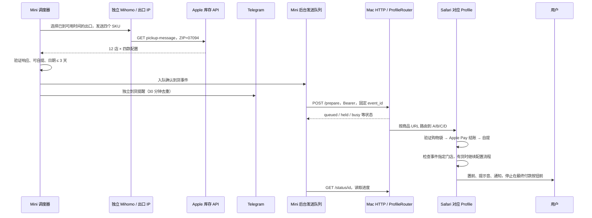

# 当前库存检测与 Safari 接手流程

依据 2026-10-26 同步的仓库代码整理。接收 Mac 的安装目录是另一份运行部署；Mini 上 git pull 不会自动升级或重启它。当前生产主入口是 `proxy_monitor.py`，不是旧的 `monitor.py` 常驻循环。



## 1. Mini 如何查询

`deploy/proxy_service.py` 启动同一个 `com.trancedu.iphone-duo-proxy-live` LaunchAgent：ZIP `07094`、四 worker、全局发起间隔至少 2 秒、同一测得出口 IP 发起间隔至少 60 秒。一次请求包含四个 SKU：

| 配置 | SKU | Safari 路由 |
|---|---|---|
| 256GB 白色 / Star White | MK1E4LL/A | A / Duo256White |
| 256GB 黑色 / Night Sky | MK1F4LL/A | B / Duo256Black |
| 512GB 白色 / Star White | MK1G4LL/A | C / Duo512White |
| 512GB 黑色 / Night Sky | MK1H4LL/A | D / Duo512Black |

请求来自 `monitor.Client.inventory_region()`：

```text
GET https://www.apple.com/shop/retail/pickup-message
    ?pl=true
    &location=07094
    &parts.0=MK1E4LL%2FA
    &parts.1=MK1F4LL%2FA
    &parts.2=MK1G4LL%2FA
    &parts.3=MK1H4LL%2FA
```

这是一个请求，不是每店一个请求，也不是每款一个请求。响应的 `body.stores[]` 含门店，每店的 `partsAvailability[SKU]` 含该配置的 `pickupDisplay`、可选标志和日期/文案。默认 07094 路径要求预期的 12 家店齐全；配置中的旧两 ZIP / 22 店区域表不等于这个生产进程在查询两 ZIP。

启动时从三个本机缓存订阅中读取节点，用独立 Mihomo 运行环境连接节点，探测并按出口 IP 去重。节点数不等于出口 IP 数，出口数也不等于当前健康数。出错出口进入持久冷却，调度器只在冷却和 60 秒限制都到期后复用。403/429/541 默认按连续错误退避 5、10、20、40、60 分钟；网络错误从 60 秒开始退避。429 或显式 Retry-After 还会触发全局等待。

2 秒是请求发起目标，不是成功刷新保证；四 worker 允许慢请求重叠。真实刷新要看成功响应完成时间差。代理出口只供库存查询，Telegram 和到 Mac 的 LAN 请求使用独立直连传输。

## 2. 什么才会触发到货

`proxy_monitor.parse_offers()` 调用 `monitor.regional_payloads()`、`parse_inventory()`。门店必须允许选择，`pickupDisplay` 必须是 available；不能包含 unavailable 文案。取货日期用编码日期与文案交叉核对，必须在美东当天至未来三天，配送日期不触发。缺门店、缺 SKU、未知结构、日期冲突按错误处理，不当作无货。

有效 offer 进入 `monitor.notify_offer()`，先写 `availability-events.jsonl` 并交给 LAN 队列，然后独立执行 Telegram 去重与发送。Telegram 同“门店 + SKU + 取货日期”30 分钟内不重复提醒。Mac 是否在线、使用 Chrome 还是 Safari、是否等待用户接手，不决定 Telegram 到货通知是否发送。

## 3. Mini 如何转发

`pickup_bridge.py` 仅在 `PICKUP_MAC_CONFIG` 已设置且 config.enabled=true 时启用。后台线程写 SQLite outbox 并 POST，库存线程不等待网络重试。事件包含：

```json
{
  "event_id": "固定的事件ID",
  "detected_at": "2026-10-26T22:40:00-04:00",
  "product_url": "https://www.apple.com/shop/buy-iphone/iphone-duo/7.6-inch-display-256gb-night-sky-unlocked",
  "store_id": "R095",
  "store_name": "Apple Fifth Avenue",
  "pickup_zip": "07094"
}
```

地址与共享密钥在私密配置/环境文件，密钥不进日志。相同门店、SKU、取货日期在 30 分钟窗口内复用 ID 和最初 payload；这是一种去抖规则，不是对库存连续性的证明。默认 POST 超时 1 秒、最多三次尝试，间隔 0.5 和 1 秒。进程重启重试仍用原 ID。超过 180 秒仍未发送的事件过期，不拿陈旧事件触发浏览器。

收到 queued/running/held 后每五秒查询状态，观察窗口最多 180 秒。网络失败及 busy、人工检查、pickup_unavailable、expired、queue_full 等结果触发故障提醒冷却，每十分钟最多一次。当前 429 queue_full 响应会先经历有限 POST 重试，再归类为接收失败；不应把它理解为无限排队。

## 4. Mac 如何接收与隔离四款商品

`server.mjs` 的 HTTP 处理器检查实际来源 IP、Bearer、JSON、事件字段和 Apple 商品 URL。`profile_router.mjs` 按完整商品 URL 路由到固定 Safari Profile，每个 Profile 有独立 `Engine` 状态文件、去重表和任务锁。

同一 ID 同内容只回旧状态；同 ID 改内容冲突。每个 Profile 同时一项任务；四个 Profile 可以独立执行，因此两个不同型号的信号可以分到两个窗口。同一 Profile 忙时，按配置返回 busy，或放入有限的 held 队列；held 过期不执行。服务重启将运行中的任务标为 interrupted，不重做加购；等待队列也不会自动重放旧事件。

Safari 后端不是通过 Playwright 控制 Safari。它通过 macOS Apple Events / AppleScript，向固定 Safari Profile 窗口执行确定的 JavaScript DOM 操作。Playwright 仍用于 Chrome 后端与本地测试。Safari 窗口按 Profile 名称发现后固定 window ID；缺失、重名或多标签歧义时停止，不能随便找一个日常窗口。

## 5. Safari 的实际工作流和付款边界

`mac_receiver/safari/shopping.mjs` 的顺序：

1. 查看购物袋。恰好同款一台就复用；空袋时才打开商品，确认型号/颜色/容量，选择 No AppleCare，Add 一次，Review Bag，再验证同款一台。其他商品、数量异常或布局未知停止。生产 Safari 这条路径不会自动清空购物袋。
2. 点击 Checkout with Apple Pay，选择 I’ll pick it up；需要 ZIP 时使用配置覆盖、事件 ZIP 或后备 ZIP。
3. 检查事件指定门店。必要时 Show more stores。明确区分“不在列表”“不可选”“结构未知”；不会改成配送或生产任意门店。
4. 目标无货时，配置允许最多十次额外刷新，刷新前再次检查；发现可用就停止刷新。门店在列表中不存在或页面不明时停止诊断，不将未知状态当作明确售罄。
5. **目标有货时，新版代码会选门店、日期和时段，点击 Continue to Pickup Details，填入已配置联系信息，最后停在 Continue with Apple Pay 前。** 时间按 preferred_slot 和最小提前量选择，不保证永远是最早时段；日期沿用已选可用日期，或第一项可用日期。
6. 窗口置前，异步提示音与通知，不点击最终 Continue with Apple Pay、不接受最终条款、不授权钱包、不提交订单。

第 5 步比最早“只到门店列表、不点任何后续 Continue”的设计走得更远。这是同步来的现有实现，本文描述其行为，不代表这次同步重新触发或改动了 Mac 的支付流程。

## 6. 如何回到待命

成功交接或不确定错误保留锁；一旦观察到可用库存或进入后续选择，后面即使误报 unavailable 也不能自动返回购物袋。明确售罄时，可配置响铃后恢复预置购物袋再释放；恢复失败仍锁住。

当前 Mac health 报告 600 秒交接闲置阈值和 300 秒待命袋刷新：已跟踪的交接页十分钟没有真实用户活动时可恢复待命；开始付款、页面变化或状态不明时保持锁。待命袋每五分钟最多刷新一次，且必须无任务、无待接收请求、页面未获焦点、同款一台且处于购物袋页。2 秒的 Safari 元数据轮询不是每两秒刷新购物袋。

手动 reset 仅允许 Mac 本机来源并明确确认，运行中不能 reset。关闭单个任务窗口和关闭整个 Safari 不同；全浏览器断开不会自动释放所有锁。

## 7. ZIP 和运行版本

`APPLE_PICKUP_ZIP` 未设置时，Mini 生产仍用 LaunchAgent 的 `--zip 07094`。设置时，在新进程加载环境后覆盖旧区域；动态采用该 ZIP 的 Apple 返回门店。`proxy_monitor.py` 和旧 `monitor.py` 均支持，事件附带实际 pickup_zip。接收端优先级：其自身 APPLE_PICKUP_ZIP > 事件 pickup_zip > JSON 后备 ZIP。

这不代表要立即切换地区。当前没有设置覆盖变量，原 07094 / 12 店和四 SKU 保留。Python 进程启动时已导入的模块不会因 git pull 自动刷新；此次代码同步没有重启监控，因此接线修正从下一次正常重启生效。Mac 的独立安装 bundle 也不会因 Mini 同步而变化。

查看运行状态和耗时使用 runtime/proxy-monitor/current.json、queries.jsonl、availability-events.jsonl、pickup-bridge/delivery.jsonl，以及 Mac /status/<event_id>。日志阶段时间可以算检测→接收→购物袋验证→自提页→最终交接；跨机器计时需时钟同步。模拟信号只验证事件和流程，不能证明当时真实有库存。
