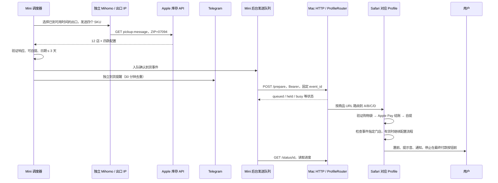
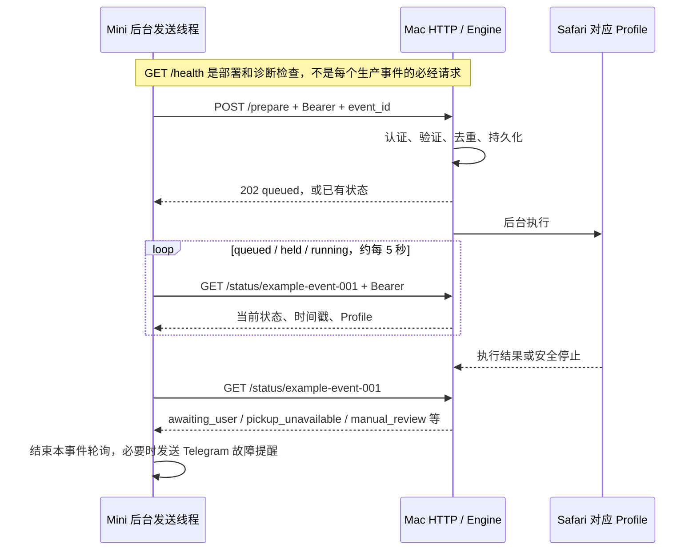

# 当前库存检测与 Safari 接手流程

2026-10-27 更新：当前生产已切换到 [纯 DataImpulse 每秒入口](dataimpulse-live.md) `dataimpulse_monitor.py`，不再运行原订阅池。下文第 1 节保留旧代理池的调度说明；库存解析、Telegram、LAN HTTP 协议和 Safari 路由仍复用相同实现。接收 Mac 是独立部署，Mini 上 git pull 不会自动升级或重启它。



## 1. Mini 如何查询

`deploy/proxy_service.py` 启动同一个 `com.trancedu.iphone-duo-proxy-live` LaunchAgent：ZIP `07094`、四 worker、常规发起间隔 2 秒、同一测得出口 IP 发起间隔至少 60 秒。一次请求包含四个 SKU：

| 配置 | SKU | Safari 路由 |
|---|---|---|
| 256GB 白色 / Star White | MK1E4LL/A | A / Duo256White |
| 256GB 黑色 / Night Sky | MK1F4LL/A | B / Duo256Black |
| 512GB 白色 / Star White | MK1G4LL/A | C / Duo512White |
| 512GB 黑色 / Night Sky | MK1H4LL/A | D / Duo512Black |

请求来自 `monitor.Client.inventory_region()`：

```text
GET https://www.apple.com/shop/retail/pickup-message
    ?pl=true
    &location=07094
    &parts.0=MK1E4LL%2FA
    &parts.1=MK1F4LL%2FA
    &parts.2=MK1G4LL%2FA
    &parts.3=MK1H4LL%2FA
```

这是一个请求，不是每店一个请求，也不是每款一个请求。响应的 `body.stores[]` 含门店，每店的 `partsAvailability[SKU]` 含该配置的 `pickupDisplay`、可选标志和日期/文案。默认 07094 路径要求预期的 12 家店齐全；配置中的旧两 ZIP / 22 店区域表不等于这个生产进程在查询两 ZIP。

启动时从三个本机缓存订阅中读取节点，用独立 Mihomo 运行环境连接节点，探测并按出口 IP 去重。节点数不等于出口 IP 数，出口数也不等于当前健康数。出错出口进入持久冷却，调度器只在冷却和 60 秒限制都到期后复用。403/429/541 默认按连续错误退避 5、10、20、40、60 分钟；网络错误从 60 秒开始退避。429 或显式 Retry-After 还会触发全局等待。

541、403 或网络错误返回后，调度器可立即换一个已就绪的出口补发，不必等下一次常规查询。优先选择最近成功且无连续错误的出口；同批错误合并为一个待补发额度，最多每滚动分钟 12 次额外请求，原池内所有发起至少间隔 0.2 秒。补发不推迟原有常规节奏，不增加四 worker 上限，不绕过同 IP 的 60 秒间隔或冷却。429 与 Retry-After 不授予快速补发，继续尊重全局退避。额度用完或没有就绪 IP 就等待正常调度。额度时间戳持久化在 state.json，重启不刷新额度；--max-recovery-per-minute 0 可关闭快速补发。

查询日志的 dispatch_reason 标记 scheduled 或 failure_recovery，后者含 recovery_from；报告的 recovery_queries 统计本次进程补发次数，target_start_spacing 表示常规节奏。

2 秒是请求发起目标，不是成功刷新保证；四 worker 允许慢请求重叠。真实刷新要看成功响应完成时间差。代理出口只供库存查询，Telegram 和到 Mac 的 LAN 请求使用独立直连传输。

可选的 [DataImpulse 按需补位](hybrid-dataimpulse.md) 在刷新空缺时追加有预算、自动到期的独立查询，结果复用下文的同一通知路径。未配置时不启用；启用后总成功间隔包含两种来源，原池 IP 统计应筛选 source=primary。

## 2. 什么才会触发到货

`proxy_monitor.parse_offers()` 调用 `monitor.regional_payloads()`、`parse_inventory()`。门店必须允许选择，`pickupDisplay` 必须是 available；不能包含 unavailable 文案。取货日期用编码日期与文案交叉核对，必须在美东当天至未来三天，配送日期不触发。缺门店、缺 SKU、未知结构、日期冲突按错误处理，不当作无货。

有效 offer 进入 `monitor.notify_offer()`，先写 `availability-events.jsonl` 并交给 LAN 队列，然后独立执行 Telegram 去重与发送。Telegram 同“门店 + SKU + 取货日期”30 分钟内不重复提醒。Mac 是否在线、使用 Chrome 还是 Safari、是否等待用户接手，不决定 Telegram 到货通知是否发送。

## 3. Mini 如何转发

`pickup_bridge.py` 仅在 `PICKUP_MAC_CONFIG` 已设置且 config.enabled=true 时启用。后台线程写 SQLite outbox 并 POST，库存线程不等待网络重试。事件包含：

```json
{
  "event_id": "固定的事件ID",
  "detected_at": "2026-10-26T22:40:00-04:00",
  "product_url": "https://www.apple.com/shop/buy-iphone/iphone-duo/7.6-inch-display-256gb-night-sky-unlocked",
  "store_id": "R095",
  "store_name": "Apple Fifth Avenue",
  "pickup_zip": "07094"
}
```

地址与共享密钥在私密配置/环境文件，密钥不进日志。相同门店、SKU、取货日期在 30 分钟窗口内复用 ID 和最初 payload；这是一种去抖规则，不是对库存连续性的证明。默认 POST 超时 1 秒、最多三次尝试，间隔 0.5 和 1 秒。进程重启重试仍用原 ID。超过 180 秒仍未发送的事件过期，不拿陈旧事件触发浏览器。

收到 queued/running/held 后约每五秒查询状态，观察期限为 Mini 持久化事件时刻起 180 秒；超时不取消 Mac 任务。网络失败及 busy、人工检查、pickup_unavailable、expired、queue_full 等结果触发故障提醒冷却，每十分钟最多一次。当前 429 queue_full 响应会先经历有限 POST 重试，再归类为接收失败；不应把它理解为无限排队。

## 3.1 两台电脑到底怎样“对话”

当前协议是 **Mini 主动发起 HTTP 请求，Mac 返回 HTTP 响应**。监听服务只在 Mac 一侧；Mini 不需要为接收执行结果开放端口。Mac 没有向 Mini 发 callback/webhook 的代码，也没有 WebSocket、服务器推送或常驻双向消息通道。底层 HTTP 可以复用 TCP 连接，但应用层不依赖一条永久连接。

Mac 的 Node 接收进程监听明确的家庭局域网 IPv4 地址和配置端口（示例 8765）。Mini 的 `pickup_bridge.local.json` 保存完整 `/prepare` 地址；状态地址从同一个地址去掉 `/prepare` 后拼接而来。两台机器不必知道对方的电脑名称，路由器按局域网 IP 转发。建议给两台机器做 DHCP 地址保留；Mac IP 变化时要更新 Mini endpoint，Mini IP 变化时要更新 Mac allowlist。

通信链路为：

```text
Mini Python urllib → 家庭局域网 → Mac Node HTTP → ProfileRouter → Safari
Mini Python urllib ← HTTP 响应  ← Mac Node HTTP ← Engine 状态记录
```

GitHub 只负责代码同步，不传递库存事件。Telegram 是另外的通知通道，不用来驱动 Safari。库存代理出口也不参与这条 LAN 链路：发送器用 `ProxyHandler({})` 绕过环境代理，`NoRedirect` 拒绝自动重定向，避免把认证请求跟随到其他地址。

## 3.2 一次 HTTP 往返与完整时序

以下为说明用示例；地址、ID、时间都不是运行配置，不含真实密钥。

```http
POST /prepare HTTP/1.1
Host: <MAC_LAN_IP>:8765
Authorization: Bearer <SHARED_SECRET>
Content-Type: application/json

{"event_id":"example-event-001","detected_at":"2026-10-26T22:40:00-04:00","product_url":"https://www.apple.com/shop/buy-iphone/iphone-duo/7.6-inch-display-256gb-night-sky-unlocked","store_id":"R095","store_name":"Apple Fifth Avenue","pickup_zip":"07094"}
```

Mac 验证后将事件写入对应 Profile 的状态，再安排后台任务。首次接收的典型响应是：

```http
HTTP/1.1 202 Accepted
Content-Type: application/json
Cache-Control: no-store

{"event_id":"example-event-001","status":"queued","profile_label":"B","product":"iPhone Duo 256GB Night Sky","timestamps":{"detected_at":"2026-10-26T22:40:00-04:00","received_at":"2026-10-27T02:40:00.100Z"}}
```

**202 只表示已接收，不表示有货、已加购或流程成功。** Mac 不会把完整购物流程阻塞在该 POST 里；但 `ProfileRouter.beforeAccept()` 可能先检查 Safari 窗口，所以回执不保证在一秒以内。若 Mini 等回执超时，不确定 Mac 是否已收到，就用原 ID 和原内容有限重试；不能生成另一个 ID 再发。



Mac 并不是主动“报回 Mini”；结果保存在 Mac，Mini 主动 GET 才读到。浏览器执行过程中，Engine 更新状态和阶段时间，HTTP 服务继续提供状态查询。无需再 POST `/prepare` 来询问进度。

## 3.3 接口、认证和返回值

这些接口共用 Mac 的接收服务，**包括 health 在内都要认证并通过来源检查**：

| 请求 | 发起方及用途 | 常见返回 |
|---|---|---|
| `GET /health` | Mini 部署脚本/诊断 CLI，或 Mac 本机检查服务、Safari 与 Profile | 200；查看 mode、browser_ready、profiles、active_event_id 等，不能仅凭 status=ok 判定钱包就绪 |
| `POST /prepare` | Mini 后台提交事件 | 新事件 202 queued/held；重复同内容 200 旧状态；409 busy/event_id_conflict；429 queue_full/event_capacity_reached；503 browser_not_ready |
| `GET /status/<event_id>` | Mini 后台或诊断 CLI 读取进度 | 200 当前状态；404 not_found；查询也会处理 held 事件过期 |
| `POST /reset` | 仅 Mac 本机，明确完成/放弃后重置 | JSON 要有 event_id 和 confirm=true；200 reset/not_active；运行中 409；LAN 来源 403 |

接收端先读 `req.socket.remoteAddress`，不是客户端声称的 `X-Forwarded-For`。只允许配置 `allowed_sources` 中的实际来源地址；IPv4-mapped 地址会先归一化。未许可来源返回 403，Bearer 错误返回 401；带浏览器 Origin 的请求返回 403，不对网页开放跨域调用。认证比较使用固定长度摘要和恒定时间比较。

事件 ID 只允许字母、数字、下划线、连字符，长度 1–128；detected_at 必须可解析且带时区。商品链接由接收端严格限制为 HTTPS、www.apple.com 和规定的 buy-iphone 配置路径，不接受账号密码、查询串、fragment 或其他网站。可选 pickup_zip 必须是五位数字。POST 要求 application/json，body 上限 8192 字节；Node 服务配置五秒请求/头部/连接超时。

Mini 配置中的 endpoint 必须是明确的 RFC1918 私网或回环 IPv4，路径 `/prepare`，无账号密码、query 或 fragment；密钥至少 32 个字符。配置虽然接受 HTTPS endpoint，但当前 Node 服务由 `http.createServer()` 提供 HTTP，并没有自行终止 TLS。HTTP 上 Bearer 是明文传输，因此只能在可信家庭网络使用，不做公网映射；若要 TLS，需要另行正确配置。

## 3.4 重试、持久化与“双层去重”

Mini 库存线程先执行不等待网络的内存入队（容量 128），后台线程才把事件写入 `runtime/proxy-monitor/pickup-bridge/outbox.sqlite3`。**SQLite 已写入的事件**可以跨重启恢复；刚进入内存、尚未持久化就进程退出的观察不能保证恢复。

Mini 的去重键是“门店 + SKU + 取货日期”的哈希，窗口 1800 秒。首次生成 UUID 并保存原 payload；重复观察、POST 超时、连接断开和进程重启不会改变该 ID/payload。Mac 再按 event_id 和规范化事件内容的 fingerprint 去重，同 ID 同内容返回旧结果，同 ID 改内容拒绝。因此“Mac 已收到，但回执丢了”不会导致重复加购。

Mini 本地 outbox 阶段是 pending → watching → done/failed，和 Mac 的 queued/held/running 等执行状态不是一回事：

| 默认值 | 代码语义 |
|---|---|
| timeout_seconds=1 | 每次 HTTP 请求超时；配置限制在 0.1–5 秒 |
| max_attempts=3 | POST 最多三次尝试；配置限制在 1–5 次 |
| retry_delays_seconds=[0.5,1] | POST 失败后的计划间隔，实际执行还受后台线程和其他事件影响 |
| 状态查询约每 5 秒 | 仅接收结果为 queued、held、running 时继续 GET；不是库存扫描频率 |
| deadline=持久化时刻+180 秒 | 从 Mini 写入事件开始计算，不是 Mac 接收后再给 180 秒；下一次后台检查才判超时，因此不是精确硬截止 |
| Telegram 故障提示冷却 600 秒 | 当前 outbox 共用一次提示额度，避免不同事件连续弹出；不改变原到货 Telegram 的 30 分钟去重 |

**Mini 观察超时不取消 Mac 任务，也不解除 Mac 锁。** 当前没有 `/cancel`。若 Mini 已停止轮询，Mac 仍可能继续执行或等待用户；到 Mac 看页面或用 status 查询，不要重新生成事件强行重做。

`409 busy` 被发送器视为明确结果并通知；`429 queue_full`、认证错误、未就绪等 HTTP 拒绝会先走有限失败重试。Mac 的 held TTL 与 Mini 的 180 秒观察期限是两套独立规则，不能当成同一个计时器。Mac 执行和 held 排队仍按第 4、6 节的每 Profile 锁与释放条件处理。

## 3.5 日志、延迟和不依赖对方的部分

Mini `delivery.jsonl` 记录检测时间、发送时间、重试次数、Mac 状态及允许记录的时间戳；Mac 在各 Profile 的 events.json/events.jsonl 保存事件与执行阶段，另有经白名单清洗的 diagnostics。Mini 目前只保留 received_at、opened_at、bag_ready_at、apple_pay_at、handoff_at、finished_at 六类接收端阶段时间；Safari 的 bag_verified_at、pickup_page_ready_at 等更多细节要查 Mac `/status/<id>` 或 Mac 日志，不能仅从 Mini 日志推断。

时间戳同时可能是 UTC 的 Z 和带美东偏移的 ISO 格式，比较前必须归一化，两台机器需自动校时。`received_at - detected_at` 是检测到接收的估计；如果 Mac 与 Mini 时钟有偏差，甚至会算出负数，不代表请求逆向传输。

HTTP 不承载共享密钥以外的登录凭证：事件中不发送 Cookie、密码或付款数据，Mini 不控制远端 Safari DOM。Safari 执行、音频和系统通知都在 Mac 上本地完成。源码同步与常驻服务部署分开；更新 Mini 仓库不会自动替换 Mac 的运行 bundle。

部署与实际验证命令见 [两机部署说明](split-pickup-deployment.md) 和 [bridge_client.py](../bridge_client.py)。生产 sender 不会在每次到货前先查 `/health`；health 是启用/诊断环节使用。Mac 离线时，Mini 有限重试并冷却提醒，库存检测和原有 Telegram 继续运行。Mini 停机后则无法接收新的库存事件；Mac 不会因此自行查库存。


## 4. Mac 如何接收与隔离四款商品

`server.mjs` 的 HTTP 处理器检查实际来源 IP、Bearer、JSON、事件字段和 Apple 商品 URL。`profile_router.mjs` 按完整商品 URL 路由到固定 Safari Profile，每个 Profile 有独立 `Engine` 状态文件、去重表和任务锁。

同一 ID 同内容只回旧状态；同 ID 改内容冲突。每个 Profile 同时一项任务；四个 Profile 可以独立执行，因此两个不同型号的信号可以分到两个窗口。同一 Profile 忙时，按配置返回 busy，或放入有限的 held 队列；held 过期不执行。服务重启将运行中的任务标为 interrupted，不重做加购；等待队列也不会自动重放旧事件。

Safari 后端不是通过 Playwright 控制 Safari。它通过 macOS Apple Events / AppleScript，向固定 Safari Profile 窗口执行确定的 JavaScript DOM 操作。Playwright 仍用于 Chrome 后端与本地测试。Safari 窗口按 Profile 名称发现后固定 window ID；缺失、重名或多标签歧义时停止，不能随便找一个日常窗口。

## 5. Safari 的实际工作流和付款边界

`mac_receiver/safari/shopping.mjs` 的顺序：

1. 查看购物袋。恰好同款一台就复用；空袋时才打开商品，确认型号/颜色/容量，选择 No AppleCare，Add 一次，Review Bag，再验证同款一台。其他商品、数量异常或布局未知停止。生产 Safari 这条路径不会自动清空购物袋。
2. 点击 Checkout with Apple Pay，选择 I’ll pick it up；需要 ZIP 时使用配置覆盖、事件 ZIP 或后备 ZIP。
3. 检查事件指定门店。必要时 Show more stores。明确区分“不在列表”“不可选”“结构未知”；不会改成配送或生产任意门店。
4. 目标无货时，配置允许最多十次额外刷新，刷新前再次检查；发现可用就停止刷新。门店在列表中不存在或页面不明时停止诊断，不将未知状态当作明确售罄。
5. **目标有货时，新版代码会选门店、日期和时段，点击 Continue to Pickup Details，填入已配置联系信息，最后停在 Continue with Apple Pay 前。** 时间按 preferred_slot 和最小提前量选择，不保证永远是最早时段；日期沿用已选可用日期，或第一项可用日期。
6. 窗口置前，异步提示音与通知，不点击最终 Continue with Apple Pay、不接受最终条款、不授权钱包、不提交订单。

第 5 步比最早“只到门店列表、不点任何后续 Continue”的设计走得更远。这是同步来的现有实现，本文描述其行为，不代表这次同步重新触发或改动了 Mac 的支付流程。

## 6. 如何回到待命

成功交接或不确定错误保留锁；一旦观察到可用库存或进入后续选择，后面即使误报 unavailable 也不能自动返回购物袋。明确售罄时，可配置响铃后恢复预置购物袋再释放；恢复失败仍锁住。

当前 Mac health 报告 600 秒交接闲置阈值和 300 秒待命袋刷新：已跟踪的交接页十分钟没有真实用户活动时可恢复待命；开始付款、页面变化或状态不明时保持锁。待命袋每五分钟最多刷新一次，且必须无任务、无待接收请求、页面未获焦点、同款一台且处于购物袋页。2 秒的 Safari 元数据轮询不是每两秒刷新购物袋。

手动 reset 仅允许 Mac 本机来源并明确确认，运行中不能 reset。关闭单个任务窗口和关闭整个 Safari 不同；全浏览器断开不会自动释放所有锁。

## 7. ZIP 和运行版本

`APPLE_PICKUP_ZIP` 未设置时，Mini 生产仍用 LaunchAgent 的 `--zip 07094`。设置时，在新进程加载环境后覆盖旧区域；动态采用该 ZIP 的 Apple 返回门店。`proxy_monitor.py` 和旧 `monitor.py` 均支持，事件附带实际 pickup_zip。接收端优先级：其自身 APPLE_PICKUP_ZIP > 事件 pickup_zip > JSON 后备 ZIP。

这不代表要立即切换地区。当前没有设置覆盖变量，原 07094 / 12 店和四 SKU 保留。Python 进程启动时已导入的模块不会因 git pull 自动刷新；此次代码同步没有重启监控，因此接线修正从下一次正常重启生效。Mac 的独立安装 bundle 也不会因 Mini 同步而变化。

查看运行状态和耗时使用 runtime/proxy-monitor/current.json、queries.jsonl、availability-events.jsonl、pickup-bridge/delivery.jsonl，以及 Mac /status/<event_id>。日志阶段时间可以算检测→接收→购物袋验证→自提页→最终交接；跨机器计时需时钟同步。模拟信号只验证事件和流程，不能证明当时真实有库存。


## Mac mini local speech (2026-10-27)

An additional independent [local stock voice service](local-stock-audio.md) tails confirmed availability events and speaks short configuration names through Mac mini Speakers. It uses a bounded queue and dedicated worker thread, with store/SKU/date deduplication and brief same-phrase coalescing. It neither changes this HTTP protocol nor blocks polling, Telegram or Mac delivery, and makes no additional inventory requests.
