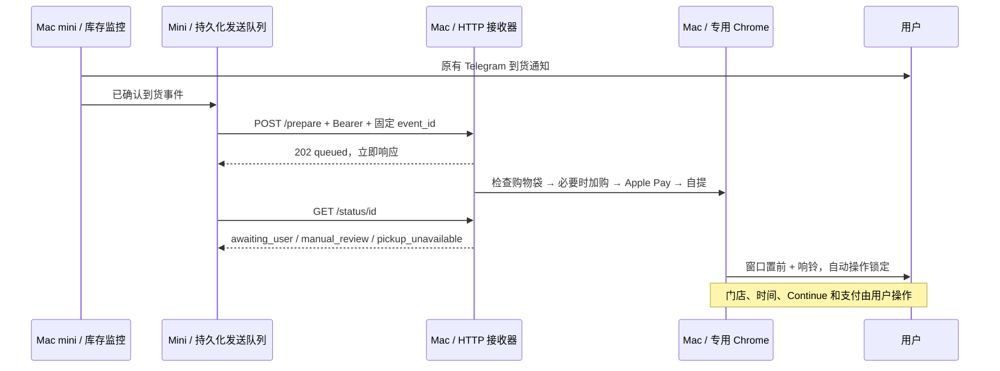

# 分离式到货响应：Mac mini 监控，Mac 浏览器接手

## 后续可选扩展

接收 Mac 新增了用户授权的 `pickup_details` 模式：指定门店、第 2 个可用取货时段、进入 Pickup Details 并填本地联系人，最后仍停在 Continue with Apple Pay 前。默认不启用；详情见 [CDP 操作说明](chrome-cdp-shopping.md)。下文原有门店列表停止边界描述均指默认模式。

## 已实现与尚需验证

Mac mini 继续原有库存检测和 Telegram；在 `monitor.notify_offer()` 确认到货的位置追加异步发送钩子，不改变库存判断。`pickup_bridge.py` 将事件持久化后发给 Mac；Mac 的独立 `mac_receiver/` 服务做浏览器准备。在检测线程中不等待 HTTP，不因 Mac 离线停库存监控。

已用 Python 单元测试、真实 Node HTTP 接收器 dry-run、Playwright 本地模拟页面测试验证协议与停止边界。**没有在另一台 Mac 上执行真实 Apple 页面、登录或 Apple Pay 测试，也没有开启到该 Mac 的真实转发。** 示例的结构选择器尚未实测，不能当作真实页面已适配。先完成本文 A、B、C，再在用户配合下做 D。



### 行为约定

- Mini 按已验证库存变化划分到货事件，无固定时间去重。持续有货复用同一个事件 ID；有效无货观察结束该轮，再次有货立即创建新 ID 并通知。API 错误、缺失门店或配置不算无货；旧请求不得回退新状态。发送重试与进程重启保留同一事件 ID。过期超过 180 秒的待发送事件不再触发浏览器。
- 默认一次 HTTP 超时 1 秒，最多 3 次 POST，间隔 0.5、1 秒，全部在后台线程。已接收后每 5 秒查询状态，最多观察 180 秒。网络错误不记录原始异常文本。
- 发送失败、busy、人工检查、全部无货等会追加 Telegram 提示，同类自动准备提示全局最多每 10 分钟一次。原有到货 Telegram 逻辑保留。
- 同 ID 同内容返回已有状态；同 ID 改内容返回冲突。忙碌事件不会排队，不会在用户接手途中执行。live 成功或失败均锁定，重启不会自动重做。
- 购物袋有完全匹配的同款一台就复用。其他商品、多个商品、配置不匹配、数量不是 1、未知布局均停下。程序不删商品；Add 调用一次，结果不确定则重新看购物袋，不重试加购。
- 程序在自提门店列表停止，不自动选择门店或时间，不点后续 Continue、Pay，不授权付款或提交订单。自动化提供“准备页面”，不保证库存保留，也不保证 Apple Pay 在专用 Chrome 中可用。

## A. 网络、地址、密钥（两台机器）

在路由器设置 DHCP 地址保留。本文示例：Mini `192.168.1.10`，Mac `192.168.1.11`；替换成你家真实地址。Mac 用 `ipconfig getifaddr en0` 查看，若网卡不同先用 `networksetup -listallhardwareports` 确认。接收服务只绑定明确的私网 IPv4，不允许 `0.0.0.0`，来源 allowlist 只列 Mini 与 `127.0.0.1`。不做公网端口转发，不放到公网反向代理，不通过 Clash 转发 LAN 请求。

LAN 上是 HTTP + Bearer，密钥不加密传输；只在可信家庭网络使用。有不可信局域网设备时应另加受信 TLS/安全隧道，不扩大源 IP 许可。允许 macOS 防火墙接收 Node 的家庭局域网连接，勿开放公网。两机时钟要自动同步，才能比较检测与接收时间。

在 **Mac** clone / pull 仓库，进入仓库根目录（下文命令默认此目录）：

```sh
git clone https://github.com/trancedu/nj-iphone-duo-monitor.git
cd nj-iphone-duo-monitor
# 已有 checkout：先 git status 确认工作区，再 git pull --ff-only
node --version
npm --prefix mac_receiver ci
cp mac_receiver/receiver.example.json mac_receiver/receiver.local.json
```

需要 Node 22+ 和本机安装的 Google Chrome。只安装 Playwright npm 包即可，`channel: chrome` 使用已有 Chrome，无需安装另一个 Chromium。

生成密钥到 Mac 本机文件，不打印它，不发到 AI 对话：

```sh
python3 - <<'PY'
from pathlib import Path
import secrets
p=Path('mac_receiver/.env')
with p.open('x') as f:
    f.write('PICKUP_SHARED_SECRET='+secrets.token_urlsafe(48)+'\n')
p.chmod(0o600)
PY
```

通过 SSH/SCP、密码管理器或 AirDrop 将**同一份**密钥安全复制到 Mini 的私密文件（例如 `pickup_bridge.local.env`），权限 `600`。不要在两台机器各生成不同密钥。`.env`、`*.local.env`、`*.local.json`、浏览器配置和 runtime 已加入忽略规则，仍应在 commit 前确认无私密内容。

## B. Mac：只启动 dry-run 接收器

先用默认回环地址本机测试，无需浏览器：

```sh
node --env-file=mac_receiver/.env mac_receiver/server.mjs --config mac_receiver/receiver.local.json
```

保持该终端运行，在另一个终端（仓库根目录）：

```sh
python3 bridge_client.py health --env-file mac_receiver/.env --endpoint http://127.0.0.1:8765
python3 bridge_client.py make-event --event mac_receiver/test-event.local.json --event-id dryrun-local-001 --url 'https://www.apple.com/shop/buy-iphone/iphone-18-pro/6.9-inch-display-256gb-black-unlocked'
python3 bridge_client.py prepare --env-file mac_receiver/.env --endpoint http://127.0.0.1:8765 --event mac_receiver/test-event.local.json
python3 bridge_client.py status --env-file mac_receiver/.env --endpoint http://127.0.0.1:8765 --event mac_receiver/test-event.local.json
# 重发同一文件，应该返回已有 dry_run_completed，不能重新执行
python3 bridge_client.py prepare --env-file mac_receiver/.env --endpoint http://127.0.0.1:8765 --event mac_receiver/test-event.local.json
```

dry-run 会得到 `queued` 后变成 `dry_run_completed`，`browser_ready: false` 正常，且无浏览器进程启动。已有 event 文件不要覆盖；下一次全新验收换文件名和 ID。同 ID 必须使用同一个 JSON（包括 detected_at），不要每次重新生成 timestamp。

Ctrl-C 停止服务。把 `receiver.local.json` 的 `host` 改为 Mac 真实 LAN IP，`allowed_sources` 改为 `["127.0.0.1", "<MINI_LAN_IP>"]`，保持 `dry_run:true`、`prewarm_browser:false`，重启同一命令。服务额外监听 `127.0.0.1:8765` 供本机重置，不接受 LAN 重置。

## C. Mini → Mac：跨机器 dry-run

在 **Mini** 的已有仓库，不要重新 clone 到第二个监控目录：

```sh
cd /Users/codex/workspace/nj-iphone-duo-monitor
cp pickup_bridge.example.json pickup_bridge.local.json
chmod 600 pickup_bridge.local.env
```

将 `pickup_bridge.local.json` endpoint 改为真实 Mac IP：`http://<MAC_LAN_IP>:8765/prepare`。暂时保留 `enabled:false`，CLI 检查不要求启用监控钩子。

```sh
python3 bridge_client.py health --config pickup_bridge.local.json --env-file pickup_bridge.local.env
python3 bridge_client.py make-event --event runtime/lan-test.local.json --event-id dryrun-mini-001 --url 'https://www.apple.com/shop/buy-iphone/iphone-18-pro/6.9-inch-display-256gb-black-unlocked'
python3 bridge_client.py prepare --config pickup_bridge.local.json --env-file pickup_bridge.local.env --event runtime/lan-test.local.json
python3 bridge_client.py status --config pickup_bridge.local.json --env-file pickup_bridge.local.env --event runtime/lan-test.local.json
python3 bridge_client.py prepare --config pickup_bridge.local.json --env-file pickup_bridge.local.env --event runtime/lan-test.local.json
```

确认 Mac 收到并且重复事件没有新执行；使用错误密钥应是 unauthorized，来自其他设备应是 source_forbidden。不要打印正确密钥测试。此阶段不触碰购物袋。

Mini 的 outbox 自动重试、离线 Telegram 冷却、检测不受影响，已覆盖自动化测试；也可在 Mac 停服务后运行下列离线演练。它使用现有 Telegram 函数，**会发送最多一条测试故障提示**，不伪造到货 Telegram、不发真实库存事件：

```sh
python3 - <<'PY'
from pathlib import Path
import json, os, time
from monitor import load_env, telegram
from pickup_bridge import Bridge
load_env('/Users/codex/.codex/secrets/market-radar.env')
load_env('pickup_bridge.local.env')
cfg=json.loads(Path('pickup_bridge.local.json').read_text())
b=Bridge(cfg,os.environ[cfg['secret_env']],'runtime/bridge-offline-test',telegram,autostart=False)
b.submit({'observed_at':__import__('datetime').datetime.now(__import__('datetime').timezone.utc).isoformat(), 'sku':'TEST-OFFLINE', 'store_id':'TEST', 'date':'test', 'url':'https://www.apple.com/shop/buy-iphone/iphone-18-pro/6.9-inch-display-256gb-black-unlocked'})
for _ in range(50):
    b.tick();time.sleep(.1)
PY
```

**先确认 Mac 服务已停**，否则上述演练会发送事件；CLI/脚本不能把 live 接收器当成 dry-run。测试用外层轮询间隔不属于浏览器固定 sleep。主监控不在此脚本中，不需要停止或改采样频率。

## D. Mac：专用浏览器验证，再由用户配合做一次 live

1. 将 `dry_run:true` 保留，改 `prewarm_browser:true`。重启接收器，它提前打开专用 headed Chrome，配置目录默认 `mac_receiver/apple-browser-profile/`。首次由用户手动完成 Apple 登录，浏览器保持打开。不要指向日常 `~/Library/Application Support/Google/Chrome`。
2. 在这套专用 Chrome 中验证 Apple Pay 是否显示、Touch ID 是否可用，确认 Apple 美国站使用英文。Playwright 启动的 Chrome 不一定与日常 Chrome 的钱包能力相同。无法使用就停下报告，不绕过 Apple 或浏览器限制，不移交登录 Cookie。
3. 用用户给的 iPhone 18 Pro Max 测试链接，**在用户配合下**核验真实页面定位。`No AppleCare coverage` 必须在 Add 前选中。核验商品标题与 URL 的型号/容量/颜色匹配。首次可能需要用户手动设置 ZIP、登录或处理同意框，这些额外步骤程序会停下。
4. 验证 `selectors.bag_item` 能选出**所有商品行**（包括与目标不同的商品），`store_list` 是可见门店列表，`store_row` 覆盖所有门店且其 radio 禁用状态能代表不可取货。示例 `[data-autom="bag-item"]`、`store-list`、`store-row` **是占位值**，根据该专用浏览器 DOM 修改。优先保留角色/标签/可访问名称，只在结构分组用已核验 selector。禁止删除购物袋检查、改成 `.first()` 任意点按钮或把未知门店当作有货。
5. 核验完成再改 `selectors_verified:true`、`dry_run:false`，重启。若有旧人工锁，先按下一节人工处理并 reset。`/health` 需要 `mode:live`、`browser_ready:true`、`active_event_id:null`；这仍不代替钱包验证。
6. 新建测试 event 文件和 ID。测试商品只使用上述 Pro Max，确认专用购物袋为空或只有这款一台，Mac 和用户都在场。先从 Mac 本机发送，再可从 Mini 发一个新的事件验证 LAN。**一次只执行一轮，处理购物袋和 reset 后才能做下一轮**。

```sh
python3 bridge_client.py make-event --event mac_receiver/live-test.local.json --event-id live-promax-001 --url 'https://www.apple.com/shop/buy-iphone/iphone-18-pro/6.9-inch-display-256gb-black-unlocked'
python3 bridge_client.py prepare --env-file mac_receiver/.env --endpoint http://127.0.0.1:8765 --event mac_receiver/live-test.local.json --allow-live
python3 bridge_client.py status --env-file mac_receiver/.env --endpoint http://127.0.0.1:8765 --event mac_receiver/live-test.local.json
# 到达 awaiting_user 后重发同一文件，必须只返回旧状态，不加购
python3 bridge_client.py prepare --env-file mac_receiver/.env --endpoint http://127.0.0.1:8765 --event mac_receiver/live-test.local.json --allow-live
```

验收只到 `I’ll pick it up` 门店列表：窗口置前、响铃、未选门店/时间、没有点击 Continue/Pay。用户继续操作。全部门店 radio 禁用应是 `pickup_unavailable`，未知 DOM / 登录 / 超时是 `manual_review`，都保留页面与人工锁。若点击 Apple Pay 后浏览器出现用户授权弹窗，也必须交给用户；不能用系统自动化批准钱包。

### 人工重置

先在 Mac 检查当前页面和购物袋并决定后续。只在明确愿意允许**下一个新事件**时，在 Mac 本机执行：

```sh
python3 bridge_client.py reset --env-file mac_receiver/.env --endpoint http://127.0.0.1:8765 --event-id live-promax-001 --confirm-reset
```

运行中不能 reset；不要删除状态文件来强制解锁。reset 不关闭页面、不清空购物袋、不重做旧事件。下一事件若看到当前购物袋的其他商品会再次停下。

## E. Mac 登录后常驻启动

先停止前台服务，避免同端口/同 profile 冲突。**只在接手购买的 Mac 上**执行安装：

```sh
python3 deploy/mac_receiver_service.py install --config mac_receiver/receiver.local.json --env-file mac_receiver/.env --node "$(command -v node)"
python3 deploy/mac_receiver_service.py start
python3 deploy/mac_receiver_service.py status
# 停止：
python3 deploy/mac_receiver_service.py stop
```

LaunchAgent 为 `com.trancedu.apple-pickup-receiver`，在登录用户 Aqua 图形会话中以 headed Chrome 运行。`caffeinate -i` 阻止空闲睡眠，不会替用户解锁/登录，也不保证合盖、手动睡眠或系统更新后可用。用户必须登录且机器保持唤醒；开机未登录/休眠/Chrome 被关闭时视为失败，由 Mini 有限重试后 Telegram 提示。服务崩溃后人工检查再启动；不在后台循环重建浏览器或继续半成订单。

## F. Mini：启用真实转发（Mac 验收之后）

将 `pickup_bridge.local.json` 改为 `enabled:true`。把这两项加到**现有库存 LaunchAgent 使用的 env 文件**（这里是 `/Users/codex/.codex/secrets/market-radar.env`），不要覆盖已有 Telegram 配置：

```dotenv
PICKUP_MAC_CONFIG=/Users/codex/workspace/nj-iphone-duo-monitor/pickup_bridge.local.json
PICKUP_SHARED_SECRET=<与Mac相同的密钥，安全复制，不粘贴到AI对话>
```

让另一位 AI/操作者在 Mini 本机安全合并文件，不输出内容。确认文件 `chmod 600`，通过现有安装脚本重启库存服务以加载新模块和环境（保留当前 12 店、四配置、节点间隔设置）：

```sh
python3 deploy/proxy_service.py stop-live
python3 deploy/proxy_service.py start-live --env-file /Users/codex/.codex/secrets/market-radar.env
python3 deploy/proxy_service.py status
```

不要启动旧的 `com.trancedu.iphone-duo-monitor` 或 watchdog，不要跑第二份监控。默认没设 `PICKUP_MAC_CONFIG` 时 bridge 完全禁用。需临时关闭转发时把 config 的 enabled 设 false 并重启库存服务；已创建的 sender 缓存配置，不动态重读。关闭 Mac 接收器不会停止 Mini 的库存检测或原有 Telegram。

## G. 测试与时间记录

在仓库根目录：

```sh
python3 -m unittest discover -s tests
npm --prefix mac_receiver test
```

Python → Node 的集成测试只监听回环，dry-run 不启动浏览器。Node 浏览器测试用临时 headless Chrome、全路由 mock，不请求 Apple、不使用专用 profile。操作系统需允许本机监听和启动 Chrome；Linux 无 Chrome 时需另行准备，目标验收环境是 macOS。

- Mini：`runtime/proxy-monitor/pickup-bridge/delivery.jsonl`，包含 detected_at、发送时刻、接收结果和 Mac 阶段时间；测试 outbox 在各自测试目录。
- Mac：`mac_receiver/runtime/events.jsonl`，包含 received_at、opened_at、bag_ready_at、apple_pay_at、handoff_at、finished_at。
- `bridge_client.py status` 自动计算 `milliseconds_since_detection`。`received_at - detected_at` 是检测→接收；`bag_ready_at - detected_at` 是检测→加购确认；`handoff_at - detected_at` 是检测→可接手。已有同款一台时 bag_ready_at 表示复用验证完成。
- 不保存完整结账页、截图、Cookie、密码或付款信息。真实 UI 出错只记录安全 reason；另一位 AI 调试时也遵守同一界限。文件和 profile 只留在各自机器本地。

## 给接手 Mac 的 AI 的执行清单

先阅读本文件与 `mac_receiver/README.md`、`browser.mjs` 的停止边界。执行 B 和 C，确认 dry-run 的认证/去重/状态。执行自动化测试。用户配合下核验专用 Chrome 登录/钱包和三个结构 selector，再做 D 的一次 live 测试，到自提门店列表立即停止。不要 Continue、选门店或时间、Pay、提交订单；不要自动删除购物袋。报告实际成功的阶段、未完成项和各阶段毫秒数。无法核验就保留 dry-run，不设置 selectors_verified，不宣称已跑通。Mac 测完后把 selector 等非敏感修正 commit/push；密钥、local config、浏览器 profile、runtime 不提交。
